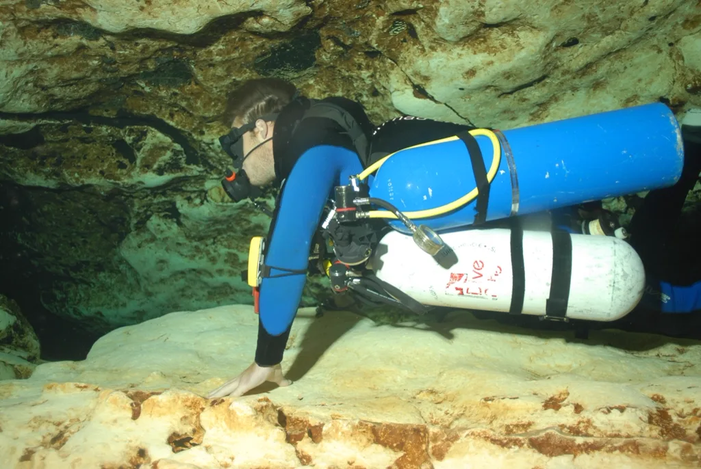
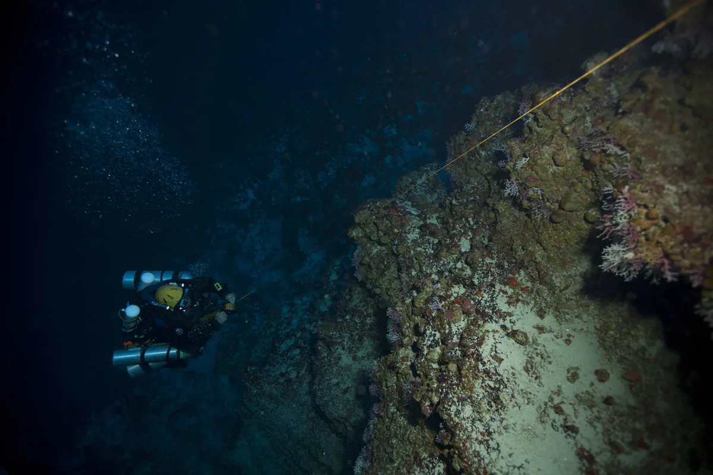

# El falso dilema del buceador técnico moderno



  <video autoplay muted loop playsinline preload="metadata" poster="/video/vdrill-bibotella.webp">
    <source src="/video/vdrill-bibotella.mp4" type="video/mp4">
  </video>



Durante décadas, dar el salto del buceo recreativo al **buceo técnico** o al **buceo en cuevas** implicaba una única respuesta automática: comprar una placa de acero o aluminio, un ala toroidal y montar un **bibotella (backmount)** unido por un colector con aislador central (*manifold*).

Hoy la realidad operativa en cuevas, pecios e inmersiones técnicas con descompresión ha cambiado por completo. El **sidemount moderno** ya no es una configuración improvisada para pasar sifones estrechos en el Reino Unido; es un sistema hidroestático, minimalista y altamente estandarizado que compite de tú a tú —y supera en numerosos escenarios— al bibotella tradicional.

Si estás valorando qué configuración elegir para tu curso [TDI Intro to Tech](/cursos/buceo-tecnico/intro-to-tech), tu iniciación a cuevas en [TDI Cavern Diver](/cursos/buceo-tecnico/cavern) o tus inmersiones técnicas, conviene analizar con rigor físico y mecánico qué ofrece cada plataforma sin dogmas de escuela.

---

## 1. Redundancia de gas: Manifold aislador vs. cilindros independientes

El argumento histórico a favor del bibotella con *manifold* es que, ante el fallo de una primera etapa, cerrar el grifo de ese poste manteniendo abierto el aislador central permite seguir respirando la totalidad del gas de ambas botellas a través del regulador restante.

Sobre el papel suena imbatible. En la práctica bajo el agua, presenta tres vulnerabilidades críticas que el **buceo en sidemount** elimina de raíz:

1. **Punto único de fallo catastrófico en el colector:** El propio puente del *manifold* añade múltiples juntas tóricas adicionales expuestas a golpes contra el techo de una cueva, un pecio o durante el transporte en barco. Una extrusión de tórica en el aislador central o un golpe en la barra de conexión vacía **ambas botellas simultáneamente** si el buceador no logra aislar a tiempo.
2. **Operación a ciegas (*Valve Drill* dorsal):** En un bibotella, cuando se produce una fuga en una primera etapa o en el aislador, los grifos están **detrás de tu nuca**. Dependiendo del grosor del traje seco, la ropa interior térmica o una lesión de hombro, alcanzar el aislador requiere flexibilidad articular y se ejecuta completamente a ciegas: no ves de qué junta exacta sale el chorro de burbujas y dependes de que tu compañero diagnostique la fuga o de seguir una secuencia mecánica de cierres mientras pierdes gas.
3. **Acceso visual e inmediato en Sidemount (*V-Drill* + *Feathering*):** En configuración **sidemount**, las dos primeras etapas y ambas griferías están a veinte centímetros de tus ojos y al alcance natural de tus manos sin arquear la espalda ni contorsionar los hombros. Ves instantáneamente si la fuga proviene del asiento de alta presión, de un latiguillo, del manómetro o de la conexión DIN. Cierras la válvula en menos de dos segundos y, si una primera etapa entra en flujo libre pero la botella sigue llena, puedes seguir respirando todo ese gas abriendo y cerrando el grifo manualmente en cada inspiración (**feathering**), algo físicamente inviable de mantener de forma sostenida con un grifo situado detrás de la nuca.

---

## 2. Hidrodinámica, centro de gravedad y trimado

Desde el punto de vista de la mecánica de fluidos, la resistencia al avance (*drag*) depende directamente del **área frontal transversal** que presenta el buceador al desplazarse en posición horizontal (*trim*).

* **Con bibotella en la espalda:** Los dos cilindros descansan *encima* del torso del buceador, aumentando la sección vertical del conjunto casi al doble. Además, el peso del acero y del plomo se sitúa por encima de los pulmones, generando un par de giro que tiende a volcar al buceador si no mantiene una tensión postural constante.
* **En configuración sidemount:** Las botellas se alojan bajo las axilas, paralelas al eje longitudinal del cuerpo, ocupando el espacio natural entre los hombros y las caderas. El área frontal se reduce drásticamente, el centro de gravedad baja hasta alinearse con el centro de flotabilidad pulmonar y mantener un trimado horizontal de 0 grados (o incluso girar 90° de costado o ponerse boca arriba para inspeccionar el techo de una caverna) resulta completamente natural.

---

## 3. Entornos bajo techo: Cuevas, cavernas y pecios

En las grandes galerías inundadas de Florida o en los cenotes turísticos más amplios de México, un bibotella cabe sin problemas. Sin embargo, en la inmensa mayoría de **cuevas y surgencias de España y Europa**, la morfología kárstica impone techos bajos, laminadores y pasos estrechos donde proteger las griferías superiores es vital.

En un entorno bajo techo ([TDI Cavern Diver](/cursos/buceo-tecnico/cavern) y niveles superiores de cueva):
* **Protección de válvulas:** En un bibotella, los grifos y el aislador son el punto más alto del perfil del buceador; cualquier roce contra el techo (*roll-off*) puede cerrar accidentalmente un grifo o dañar el *manifold*. En sidemount, las válvulas quedan protegidas bajo el pecho y las axilas.
* **Paso de restricciones:** Si un pasaje se estrecha en altura o anchura, el buceador en sidemount desengancha el mosquetón inferior de una o ambas botellas en dos segundos y las proyecta hacia delante (*stage style*), reduciendo su perfil al grosor exclusivo de su propio cuerpo.

---

## 4. Ergonomía fuera del agua, entradas de costa y logística de viaje

Un porcentaje muy alto de lesiones en el buceo técnico no ocurre a 50 metros de profundidad, sino en la escalera del barco, caminando por las rocas en una entrada de infantería en la **Costa Brava** o cargando un bibotella de 2x12L (más de 38 kg fuera del agua) sobre las vértebras lumbares.

* **Salud articular y entradas desde costa:** En sidemount entras al agua con el arnés limpio en la espalda y puedes colocarte las botellas una a una en superficie con total comodidad, o transportarlas individualmente (una en cada mano o en dos viajes cortos) sin comprimir la columna vertebral. Al finalizar la inmersión, entregas las botellas a la embarcación antes de subir por la escalerilla.
* **Logística y viajes de buceo:** Conseguir un bibotella con aros y *manifold* de alquiler fuera de centros estrictamente técnicos es difícil y caro. En cambio, un arnés de sidemount pesa apenas 2,5 kg en la maleta y te permite realizar buceo técnico redundante en cualquier lugar del mundo utilizando dos botellas estándar de alquiler (como las ubicuas S80 de aluminio).
* **Botellas de etapa y descompresión:** Existe el mito de que el sidemount es incómodo cuando se añaden botellas de descompresión (*stages*). Con una configuración técnica bien ajustada ([TDI Sidemount](/cursos/buceo-tecnico/sidemount)), las botellas de fondo van pegadas al plano dorsal-lateral y las etapas de Nitrox u Oxígeno se clipan limpiamente por delante o en rotación sin interferir con la propulsión ni con el acceso a las válvulas.

---

## Resumen comparativo: ¿Cuándo elegir cada sistema?

| Criterio | Bibotella (Backmount DIR) | Sidemount Técnico |
| :--- | :--- | :--- |
| **Acceso visual a griferías** | Nulo (detrás de la cabeza, operación al tacto) | Total e inmediato (frente a los ojos) |
| **Redundancia ante fallo de tórica** | Vulnerable a fallo en el aislador del *manifold* | 100 % independiente entre ambos cilindros |
| **Área frontal e hidrodinámica** | Mayor sección vertical | Mínima sección frontal (cilindros alineados al torso) |
| **Cuevas estrechas y restricciones** | Limitado por la altura del bibotella en la espalda | Superior (permite adelantar botellas al instante) |
| **Espalda e infantería / barco** | Carga lumbar severa (>35 kg en bloque) | Mínima carga vertebral (transporte individual) |
| **Viajes y alquiler de botellas** | Requiere centros con dobles y *manifold* | Compatible con cualquier par de botellas S80/acero |

---

## ¿Quieres probar la diferencia en el agua con criterio técnico?

Tanto si vienes del buceo recreativo y quieres construir tus cimientos directamente en montaje lateral con el curso [TDI Intro to Tech](/cursos/buceo-tecnico/intro-to-tech), como si ya eres buceador de bibotella y quieres dominar la configuración lateral en nuestro curso [TDI Sidemount](/cursos/buceo-tecnico/sidemount) en **L'Escala (Costa Brava)** y **Barcelona**, trabajamos con grabación en vídeo de alta definición en cada inmersión para pulir al milímetro tu trimado, el enrutado de latiguillos y la resolución de emergencias reales.
