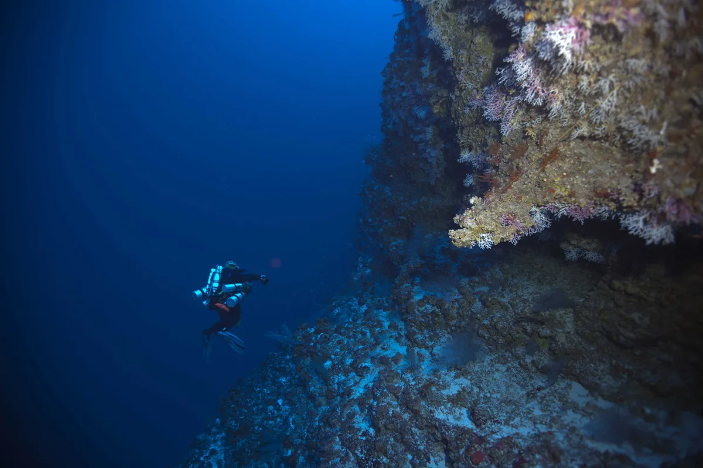
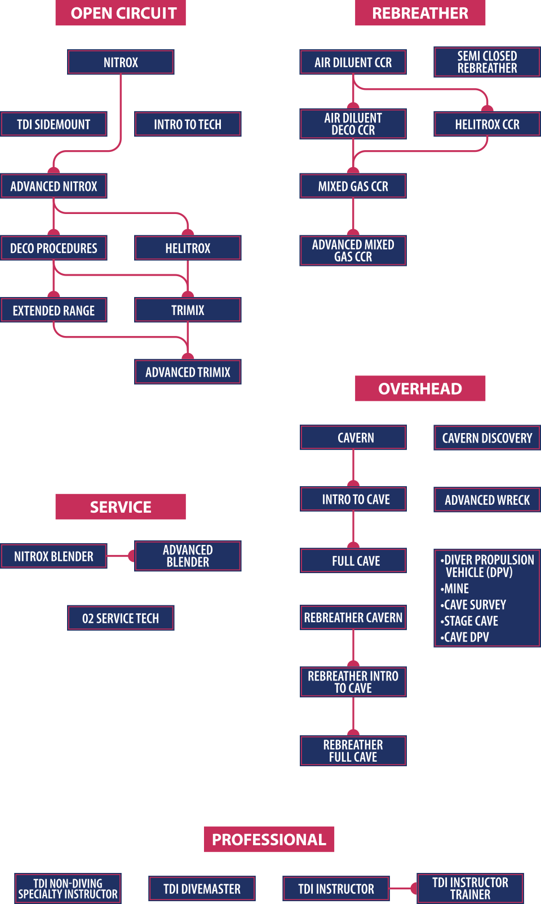

# El salto del buceo recreativo al buceo técnico



  <video autoplay muted loop playsinline preload="metadata" poster="/video/fuentenavina-dpv.webp">
    <source src="/video/fuentenavina-dpv.mp4" type="video/mp4">
  </video>



Todo buceador comprometido llega tarde o temprano a un punto de inflexión: acumulas decenas de inmersiones recreativas, tienes el título *Advanced Open Water* y *Nitrox*, pero notas que tu control en el agua aún depende de mover las manos, que tu consumo de gas podría ser mucho más estable o que te gustaría explorar pecios profundos, cavernas y cuevas donde el ascenso directo a la superficie ya no es posible.

Existe el mito de que el **buceo técnico** consiste únicamente en bajar a 70 metros respirando Trimix cargado con cuatro botellas de descompresión. En realidad, **el buceo técnico empieza mucho antes de superar los límites de no descompresión**: empieza en la arquitectura del equipo, la precisión milimétrica de la flotabilidad, la postura hidrodinámica (*trim*), las técnicas de propulsión y la autosuficiencia mental bajo estrés.

---

## ¿Qué diferencia realmente al buceo técnico del buceo recreativo?

En el buceo recreativo convencional (hasta 40 metros, sin paradas de descompresión obligatorias y en aguas abiertas), ante cualquier problema grave siempre existe la opción de abortar la inmersión y ascender directamente a la superficie.

En el **buceo técnico** operamos bajo un **techo físico o fisiológico** (*overhead environment*):
* **Techo físico:** El techo de roca de una caverna o cueva ([TDI Cavern Diver](/cursos/buceo-tecnico/cavern)) o el interior de un barco hundido.
* **Techo fisiológico (descompresión):** Una obligación de paradas de descompresión que te impide salir directamente a la superficie sin sufrir una enfermedad descompresiva grave (analizamos cómo se modelan matemáticamente estos límites en nuestro artículo sobre [valores M y Gradient Factors en Bühlmann ZHL-16](/articulos/valores-m-gradient-factors-buhlmann/)).

Cuando no puedes subir directamente a la superficie, la filosofía cambia por completo:
1. **Redundancia total de soporte vital:** Dos sistemas de gas independientes o aislables, dos reguladores completos (con latiguillo largo de 2 metros para donación de gas en línea), iluminación primaria y dos luces de respaldo.
2. **Estabilidad absoluta en la columna de agua:** Un buceador técnico debe ser capaz de permanecer inmóvil a 10 centímetros de un fondo de limo fino sin levantar una sola partícula de sedimento, resolver un cierre de grifería o lanzar una boya deco (SMB) sin variar su cota ni 30 centímetros.
3. **Planificación matemática de gases:** Cálculo real de la tasa de consumo en superficie (*SAC / RMV*), aplicación estricta de la **regla de los tercios** o *rock bottom* (gas mínimo de reserva para sacar a dos buceadores desde el punto más profundo hasta la primera parada o la superficie).

---

## El error más común al empezar: comprar equipo antes de formarse

Uno de los errores más caros en el buceo es comprar un equipo "técnico" guiándose por foros o modas antes de recibir formación en fundamentos. Muchos buceadores invierten miles de euros en chalecos híbridos plagados de anillas innecesarias, latiguillos mal enrutados o configuraciones dorsales pesadas que luego resultan inadecuadas para el tipo de buceo que realmente quieren practicar en España.

Antes de decidir tu equipo definitivo, debes elegir tu **plataforma base**:
* **Configuración Sidemount (Montaje Lateral):** Dos cilindros independientes situados a los lados del torso. Ofrece acceso visual directo a las válvulas, mínima resistencia hidrodinámica, transporte ligero fuera del agua (ideal para entradas de costa en la **Costa Brava** o barco) y versatilidad total tanto para aguas abiertas como para cuevas estrechas. (Puedes ver el análisis detallado en nuestra comparativa [Bibotella vs Sidemount en Buceo Técnico](/articulos/bibotella-vs-sidemount/)).
* **Configuración Backmount (Bibotella):** Dos cilindros en la espalda unidos por un *manifold* aislador sobre placa metálica y ala.

---

## La ruta formativa lógica en TDI (Technical Diving International)

**Technical Diving International (TDI)** es la agencia certificadora de buceo técnico más grande y reconocida del mundo. Su estructura pedagógica permite construir los cimientos paso a paso sin lagunas de seguridad:

### Paso 1: Dominar la base — TDI Intro to Tech y TDI Sidemount
El verdadero pilar de todo buceador técnico no es el curso de descompresión, sino el curso de fundamentos:
* **[TDI Intro to Tech](/cursos/buceo-tecnico/intro-to-tech):** Es el curso donde transformamos tu posición en el agua. Trabajamos intensivamente con grabación en vídeo para alcanzar un **trimado horizontal perfecto (0°)**, dominar los cinco estilos de aleteo técnico (*frog kick*, *modified frog kick*, *modified flutter*, *back kick* —nadar hacia atrás— y *helicopter turn* —girar sobre tu propio eje sin usar las manos—) y automatizar los protocolos de compartición de gas con latiguillo largo (*S-Drills*) y gestión de fallos de válvulas (*V-Drills*).
* **[TDI Sidemount](/cursos/buceo-tecnico/sidemount):** Si eliges el montaje lateral como tu configuración principal (la opción más versátil hoy en día), en este curso aprendes a configurar al milímetro el arnés, el ala y el lastre, gestionar el consumo alterno de cilindros independientes (*gas switch*) para mantener la simetría hidrostática y operar las botellas con una sola mano en cualquier situación.

*(Muchos alumnos optan por combinar los fundamentos de **TDI Intro to Tech** directamente en configuración **TDI Sidemount**, ahorrando tiempo y construyendo desde el primer día una memoria muscular única).*

### Paso 2: Dominar el traje seco — SDI/TDI Dry Suit Diver
En el Mediterráneo (especialmente en invierno y primavera en la Costa Brava) y en la totalidad de las cuevas y surgencias de la península ibérica, las inmersiones técnicas requieren protección térmica avanzada. Dominar la gestión de la burbuja de gas en un [curso de Traje Seco](/cursos/buceo-recreativo/drysuit) sin que interfiera con tu trimado ni con tus paradas de descompresión es un requisito indispensable antes de afrontar inmersiones largas.

### Paso 3: Elegir tu especialidad — Entorno bajo techo (Cuevas) o Profundidad (Descompresión)
Una vez que tu flotabilidad, tu propulsión (incluyendo patada atrás y giro helicóptero) y tu gestión de válvulas son automáticas, se abren dos grandes caminos (que a menudo convergen):
1. **Rama de Entornos Bajo Techo (Cuevas):** Comenzando por el curso [TDI Cavern Diver](/cursos/buceo-tecnico/cavern) (navegación con carrete e hilo guía, visibilidad cero, regla de los tercios y trabajo en equipo dentro de la zona de luz), para progresar posteriormente hacia *TDI Intro to Cave* y *TDI Full Cave Diver*.
2. **Rama de Profundidad y Gases (Decompression Procedures & Advanced Nitrox):** Donde aprendes a utilizar mezclas hiperóxicas de descompresión (EAN50, Oxígeno 100 %) en botellas de etapa (*stage cylinders*) para acelerar la eliminación de nitrógeno en inmersiones más allá de los límites recreativos, configurando con criterio los [Factores de Gradiente](/articulos/valores-m-gradient-factors-buhlmann/) en tu ordenador de buceo.

---

## ¿Qué requisitos necesitas para empezar hoy mismo?

No necesitas ser un atleta ni tener 500 inmersiones para iniciar tu formación en fundamentos técnicos:
* **Para [TDI Intro to Tech](/cursos/buceo-tecnico/intro-to-tech) o [TDI Sidemount](/cursos/buceo-tecnico/sidemount):** Basta con tener la certificación **Open Water Scuba Diver** (con un mínimo de 10 a 25 inmersiones registradas) y, sobre todo, la actitud mental adecuada: ganas de pulir detalles, aceptar la autocrítica viendo tus propios vídeos bajo el agua y buscar la excelencia técnica.
* **Dónde entrenamos:** Impartimos todos nuestros cursos en **L'Escala (Costa Brava)** y **Barcelona**, seleccionando puntos de inmersión con fondos y perfiles específicos para entrenar cada habilidad sin prisas.

Si tienes dudas sobre qué punto de partida encaja mejor con tu experiencia actual o quieres asesoramiento antes de comprar equipo, [escríbenos desde la página de contacto](/contacto/) o por WhatsApp y diseñamos tu plan de entrenamiento.
