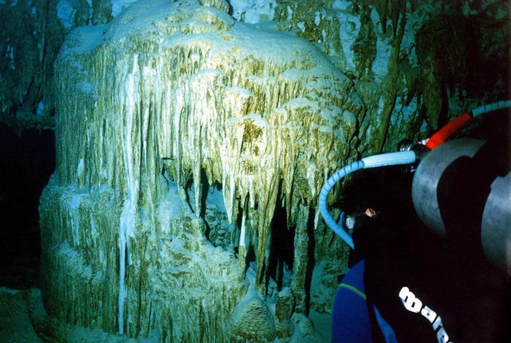
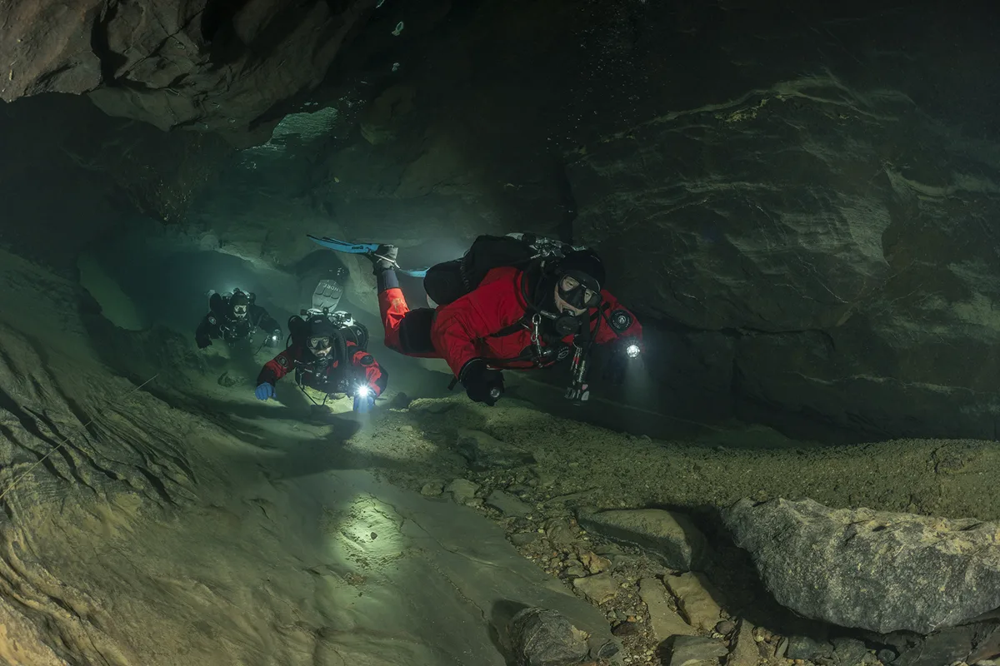
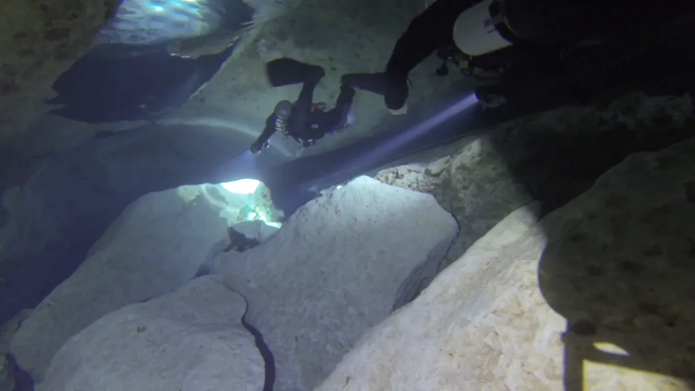

# La fascinación y el rigor del buceo en cuevas



  <video autoplay muted loop playsinline preload="metadata" poster="/video/cave-training.webp">
    <source src="/video/cave-training.mp4" type="video/mp4">
  </video>



El **buceo en cuevas** (*cave diving*) es considerado la cumbre técnica y psicológica del submarinismo. Explorar galerías subterráneas esculpidas durante millones de años, donde el agua alcanza una transparencia cristalina imposible de ver en el mar y el silencio es absoluto, ofrece una experiencia incomparable.

Sin embargo, el entorno subterráneo no perdona la improvisación. A diferencia del mar abierto, donde una emergencia puede resolverse ascendiendo verticalmente hacia la superficie, en una cueva o caverna existe un **techo físico de roca** entre el buceador y el aire exterior. La salida no está arriba: puede estar a decenas o cientos de metros en horizontal.

Por ello, todas las agencias internacionales de espeleobuceo y buceo técnico —encabezadas por **TDI (Technical Diving International)**— estructuran el aprendizaje en **tres niveles progresivos e innegociables**: **Cavern Diver (Caverna)**, **Intro to Cave** y **Full Cave Diver**.

---

## ¿Qué diferencia hay entre una Caverna y una Cueva en buceo?

En el lenguaje coloquial suelen usarse como sinónimos, pero en el buceo técnico la frontera entre **caverna** y **cueva** está definida por parámetros geométricos y operativos estrictos:

### 1. Zona de Caverna ([TDI Cavern Diver](/cursos/buceo-tecnico/cavern))
La caverna comprende la zona bajo techo donde **la luz natural del sol sigue siendo siempre visible** desde cualquier punto de la inmersión. Sus límites operativos en TDI son muy claros:
* **Distancia lineal máxima a la superficie:** 61 metros (200 pies) sumando penetración horizontal y profundidad vertical.
* **Profundidad máxima:** 40 metros (130 pies) o el límite de la certificación previa del alumno.
* **Sin descompresión obligatoria:** Se opera siempre dentro de los límites de no descompresión (NDL).
* **Sin restricciones estrechas:** Los pasajes deben ser lo bastante amplios para que dos buceadores puedan nadar en paralelo cómodamente.

### 2. Zona de Cueva (Intro to Cave y Full Cave)
En el instante en que doblas una esquina, atraviesas un pasaje donde **deja de verse la luz natural de la entrada** o superas los 61 metros lineales desde la superficie, has entrado técnicamente en una **cueva**. Aquí la dependencia de tus tres fuentes de iluminación, de tu reserva redundante de gas y de la continuidad ininterrumpida del **hilo guía (línea de vida)** hacia el exterior es total.

---

## Los 3 escalones de la formación en cuevas TDI

Nadie se convierte en espeleobuceador en un fin de semana. El entrenamiento se divide en tres fases diseñadas para asimilar procedimientos de emergencia sin saturar cognitivamente al alumno:

### Fase 1: TDI Cavern Diver (El cimiento obligatorio)
Aunque nunca tengas intención de adentrarte kilómetros en la oscuridad total, el curso **[TDI Cavern Diver](/cursos/buceo-tecnico/cavern)** transforma radicalmente tu nivel como buceador. Es el laboratorio donde aprendes:
* **Propulsión anti-sedimento:** Dominar el *frog kick*, el *modified flutter*, el *back kick* (retroceso preciso) y el *helicopter turn* para no levantar el limo del fondo (*silt-out*), que en segundos puede reducir la visibilidad de 30 metros a cero absoluto.
* **Tendido y recogida del hilo guía con carrete primario (*reel*):** Realizar amarres primarios (*tie-offs*) fuera del entorno bajo techo, amarres secundarios (*placements*) sobre la roca sin dañar las formaciones y mantener una tensión perfecta en la línea.
* **Regla de los Tercios:** Utilizar un máximo de $\frac{1}{3}$ del gas disponible para la penetración, reservando $\frac{1}{3}$ para el regreso y $\frac{1}{3}$ intacto para emergencias de un compañero.
* **Emergencias en visibilidad cero:** Salir siguiendo el hilo guía con máscara ciega (simulando pérdida total de visibilidad por sedimento o fallo de luces), compartiendo gas con el compañero en contacto táctil (*touch contact*).

### Fase 2: TDI Intro to Cave Diver (Introducción a la Cueva)
Una vez consolidada la destreza con el carrete y el control postural en el nivel de caverna, el curso **TDI Intro to Cave** permite adentrarse más allá de la luz natural:
* **Navegación por línea principal (*main line*):** El buceador aprende a conectar su carrete primario con la línea permanente instalada en la cueva y avanzar por la galería principal sin tomar bifurcaciones (*sin jumps ni tees*).
* **Gestión de gases con cilindros independientes:** En configuración [sidemount](/cursos/buceo-tecnico/sidemount), se perfecciona el cambio periódico de regulador (*rule of thirds + gas switching*) para mantener siempre equilibrada la presión de ambas botellas ante cualquier fallo catastrófico de un cilindro.
* **Límite de penetración:** Determinado por el consumo de $\frac{1}{3}$ del gas inicial en línea continua simple.

### Fase 3: TDI Full Cave Diver (Espeleobuceador Completo)
Es el nivel superior de certificación en cuevas. Aquí el buceador domina la navegación compleja tridimensional dentro de un sistema kárstico:
* **Navegación avanzada (*Jumps, Gaps y Circuits*):** Uso de carretes secundarios (*spools*) para tender puentes entre la línea principal y galerías laterales (*jumps*), atravesar tramos discontinuos (*gaps*) y realizar travesías o circuitos completos marcando inequívocamente la dirección de salida con flechas (*line arrows*) y marcadores personales (*cookies* o *REM*).
* **Pasos estrechos y restricciones:** Técnicas avanzadas de perfil bajo —donde el **buceo en sidemount** demuestra su superioridad absoluta al permitir desclipar y adelantar las botellas para franquear laminadores—.
* **Planificación con descompresión y resolución de problemas complejos:** Pérdida de línea en galería profunda, compañero perdido, enganches (*entanglements*) en visibilidad cero y fallos múltiples de equipo.

---

## ¿Por qué formarse en Sidemount para bucear en cuevas en España y Europa?

Mientras que en algunas cuevas turísticas de Florida las galerías parecen túneles de metro donde el bibotella dorsal fue el estándar durante los años 80 y 90, **el origen real del sidemount nació en las cuevas europeas** (puedes leer los detalles en nuestra [Historia del buceo sidemount](/articulos/historia-sidemount/)).

En las surgencias y cuevas de España (Burgos, Cantabria, País Vasco, Levante, Baleares o Cataluña) y del sur de Francia (Lot / Dordoña):
1. **Accesos y porteos:** Muchas entradas exigen caminar por senderos escarpados, bajar escaleras o cruzar tramos someros donde transportar dos botellas individuales de sidemount es infinitamente más seguro y ergonómico que cargar un bibotella a la espalda.
2. **Morfología de las galerías:** Los techos bajos y las restricciones hacen que llevar las válvulas protegidas bajo las axilas y poder adelantar los cilindros sea una ventaja decisiva de seguridad y conservación de la cueva.
3. **Redundancia real sin *manifold*:** Dos sistemas completamente independientes con control visual directo de los manómetros y las griferías.

---

## ¿Por dónde empezar tu camino hacia las cuevas?

La ruta más sólida, segura y eficiente para prepararte consiste en dos pasos en aguas abiertas y entorno de caverna en la **Costa Brava (L'Escala)** y **Barcelona**:

1. **Dominar la plataforma lateral:** Completar el curso **[TDI Sidemount](/cursos/buceo-tecnico/sidemount)** (o combinarlo con **[TDI Intro to Tech](/cursos/buceo-tecnico/intro-to-tech)**) hasta que el trimado horizontal, la patada hacia atrás (*back kick*) y el manejo de las dos botellas sean una segunda naturaleza.
2. **Aprender los protocolos bajo techo:** Realizar el curso **[TDI Cavern Diver](/cursos/buceo-tecnico/cavern)**, donde entrenarás el uso del carrete, el tendido de línea, la comunicación lumínica/táctil y las salidas en visibilidad cero.

¿Listo para dar el primer paso hacia el mundo subterráneo con estándares TDI? [Contacta con nosotros](/contacto/) y planificamos tus fechas de entrenamiento.
