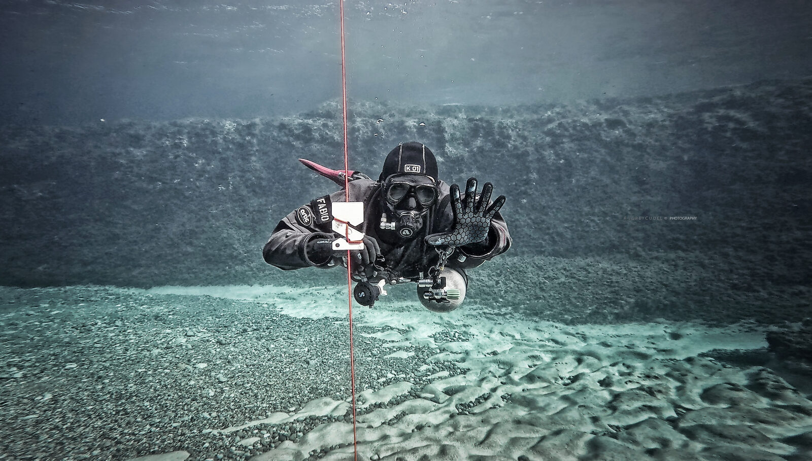
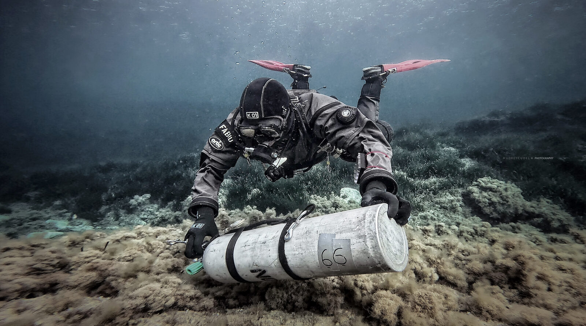
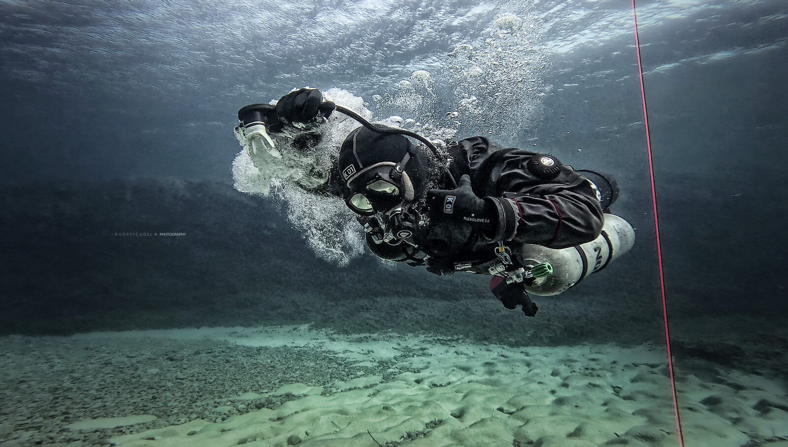

# ¿Qué es el buceo sidemount?



  <video autoplay muted loop playsinline preload="metadata" poster="/video/fuentenavina-hero.webp">
    <source src="/video/fuentenavina-hero.mp4" type="video/mp4">
  </video>



El **sidemount**, o buceo en montaje lateral, es una configuración en la que las botellas principales se llevan a los lados del cuerpo en lugar de en la espalda. Cada botella se sujeta al arnés y queda aproximadamente paralela al torso. Lo habitual es utilizar dos botellas independientes, cada una con su regulador y manómetro, aunque también se puede bucear con una sola.

La diferencia se nota antes de entrar en el agua. Puedes transportar las botellas por separado, ponerte el arnés sin el peso de un bibotella y, cuando las condiciones lo permiten, colocarte las botellas en el agua. Durante la inmersión, las griferías quedan a tu alcance, delante de ti, y puedes gestionar cada suministro de gas de forma independiente.

En Sidemount Spain enseñamos esta configuración porque creemos que sus ventajas van mucho más allá de las cuevas donde empezó a desarrollarse. También tiene sentido en una inmersión recreativa, en una entrada desde costa o en un viaje de buceo.

## De la exploración de cuevas al buceo recreativo

Las raíces del sidemount están ligadas a los espeleobuceadores británicos que necesitaban transportar su equipo por cuevas y atravesar sifones y pasos estrechos. Las botellas desmontables y las configuraciones compactas respondían a un problema muy concreto: avanzar donde un equipo voluminoso a la espalda dificultaba el paso.

Con el tiempo, el montaje lateral se adaptó a cuevas inundadas que exigían nadar durante más tiempo, con mayor atención a la flotabilidad y a la posición de las botellas. Después se extendió al buceo técnico y recreativo en aguas abiertas. Si te interesa esa evolución, puedes leer la [historia del sidemount](/articulos/historia-sidemount/).

## Cómo funciona una configuración sidemount

Un equipo de dos botellas suele incluir un arnés con su sistema de flotabilidad, dos botellas independientes, dos reguladores y un manómetro para cada botella. Las griferías se mantienen cerca del cuerpo mediante elásticos o sistemas de sujeción, y la parte inferior de cada botella se engancha al arnés. La disposición exacta varía según el equipo, las botellas y el buceador.

El ajuste importa. No basta con colgar dos botellas a los lados: hay que adaptar el arnés, la posición de las botellas, los latiguillos y el lastre para poder alcanzar el equipo, mantener una posición cómoda y controlar la flotabilidad. Una configuración bien ajustada deja las botellas próximas al cuerpo sin dificultar el movimiento.

Con dos botellas independientes también cambia la gestión del gas. Hay que controlar ambos manómetros, alternar los reguladores según el plan aprendido y conservar una reserva adecuada para la inmersión y sus posibles incidencias. Llevar dos botellas no garantiza por sí solo que la reserva sea suficiente.

## Ventajas del sidemount

### Porteo y entradas desde costa

Una de las mayores ventajas aparece fuera del agua. Un bibotella backmount unido por aros y manifold suele transportarse como un conjunto. En sidemount puedes mover las botellas individualmente y decidir cómo repartir la carga: llevar una en cada mano, hacer varios viajes o usar una mochila apropiada si prefieres llevar ambas a la espalda.

Esto importa especialmente en accesos a cuevas, senderos irregulares y entradas de infantería, como las que encontramos en la Costa Brava. Caminar con un conjunto pesado a la espalda por rocas, escalones o terreno resbaladizo puede dificultar el equilibrio y hacer más seria una caída. Poder organizar el porteo por partes da más opciones para adaptarse al lugar y a la persona.

Tampoco hace falta cargar siempre con las botellas puestas al entrar o salir: cuando la profundidad, el oleaje y el punto de acceso lo permiten, se pueden colocar o retirar en el agua. En un barco, la posibilidad de pasar las botellas por separado también puede facilitar la maniobra. Hay que planificarla según las condiciones y la ayuda disponible; hacerlo en el agua no es siempre la opción más segura.

### Griferías accesibles

Con las botellas a los lados, las griferías y primeras etapas están delante del buceador y normalmente resultan más fáciles de alcanzar y observar. Eso permite comprobar el equipo y actuar sobre las válvulas sin tener que buscarlas detrás de la cabeza.

En un bibotella backmount con manifold, el ejercicio de cierre de válvulas o *V-drill* entrena una habilidad necesaria para gestionar determinados fallos. Nuestra preferencia por el sidemount responde a una diferencia práctica: alcanzar válvulas a la espalda depende de la movilidad, del traje y de la posición del equipo, y una avería real añade pérdida de gas, estrés y posiblemente mala visibilidad. Practicar el ejercicio es importante, pero completarlo en condiciones controladas no garantiza que resulte igual de sencillo durante una emergencia.

La accesibilidad lateral tampoco convierte una avería en algo automático: hay que reconocer el problema y practicar su resolución. Sí nos permite trabajar con las válvulas en una posición que consideramos más accesible y funcional.

### Dos suministros independientes

En una configuración lateral habitual, cada botella tiene su propia grifería, regulador y manómetro, sin un manifold que comunique ambas botellas. Una fuga en un sistema no vacía directamente la otra botella a través de un colector común. A cambio, el buceador debe vigilar y gestionar por separado los dos suministros.

Un bibotella con manifold permite acceder al gas de ambas botellas a través del regulador operativo en determinados fallos, pero incorpora un colector y requiere saber identificar y aislar correctamente las averías. Preferimos la independencia y el acceso directo del sidemount, siempre con una planificación que contemple cuánto gas queda disponible tras una incidencia.

### Control de una válvula y feathering

El acceso a la grifería también permite aplicar, cuando procede, una técnica de contingencia llamada *feathering*: controlar manualmente la válvula para limitar la pérdida de gas de un regulador en flujo libre y aprovechar el gas restante. Es una habilidad especializada que se practica con formación y supervisión adecuadas, no un procedimiento que deba aprenderse a partir de un artículo.

Su utilidad depende del fallo, del gas disponible, del entorno y de la capacidad del buceador para mantener el control y salir o completar el ascenso previsto. No sustituye la reserva ni el uso de un regulador operativo. Con una válvula situada detrás de la cabeza, mantener ese control manual mientras se respira resulta mucho más difícil que con la grifería accesible a un lado.

### Comodidad y posición en el agua

Al situar las botellas a los lados, el peso y la flotabilidad se distribuyen de forma diferente. Un arnés bien ajustado, junto con el lastre y las botellas adecuados, ayuda a encontrar una posición horizontal estable y a mantener el equipo cerca del cuerpo.

Para algunos buceadores también es más cómodo no cargar un conjunto pesado a la espalda y poder alcanzar las griferías sin forzar los hombros. Esa comodidad depende del ajuste, la anatomía, el traje y las condiciones: el sidemount se aprende y se configura para cada persona, no se resuelve simplemente cambiando de chaleco.

### Flexibilidad para viajar y elegir botellas

El equipo lateral permite utilizar botellas individuales sin necesitar un juego emparejado y unido por aros y manifold. Según el destino encontrarás botellas de acero o aluminio, de distintos tamaños y con diferentes griferías. Conviene consultar antes con el centro qué material tiene disponible y si es compatible con tu configuración.

El arnés y el ala pueden resultar prácticos para viajar, pero su peso y volumen varían según el modelo. Lo importante es que puedes adaptar la configuración a las botellas y al tipo de inmersión, sin depender necesariamente de encontrar un bibotella montado.

## Sidemount en cuevas y pecios

En entornos bajo techo, el perfil de las botellas y la posibilidad de manipularlas son ventajas para buceadores con formación específica. Una configuración lateral bien ajustada puede facilitar el avance en ciertos pasos y permite modificar la posición de las botellas cuando la técnica y el entorno lo requieren.

Esto no significa que cualquier paso sea seguro ni que el tamaño del cuerpo sea el único límite: el equipo, la visibilidad, el hilo guía, el espacio para maniobrar y la salida forman parte de la decisión. El sidemount por sí solo no habilita para penetrar en cuevas o pecios; esas inmersiones requieren formación, planificación y experiencia específicas.

## ¿Se puede bucear en sidemount con una sola botella?

Sí. La configuración con una sola botella lateral suele llamarse *monkey diving*. Puede ser útil en determinadas inmersiones recreativas o situaciones especializadas, siempre que el equipo y el lastre estén adaptados para mantener el equilibrio.

Una sola botella principal no ofrece la independencia de gas de una configuración con dos. La reserva y las contingencias deben planificarse de acuerdo con la inmersión y el equipo disponible.

## ¿Es lo mismo llevar una etapa lateral que bucear en sidemount?

No exactamente. Un buceador en backmount o con un rebreather puede llevar una botella de etapa, descompresión o bailout a un lado. Esa botella está montada lateralmente, pero su equipo principal sigue siendo backmount o CCR. En sidemount, las botellas principales se llevan a los lados y la configuración y los procedimientos se organizan alrededor de ellas.

## ¿Necesito un curso de sidemount?

Recomendamos formación específica incluso si ya tienes experiencia en backmount. El curso sirve para ajustar el equipo a tu cuerpo, practicar la flotabilidad y el trim, aprender a gestionar dos fuentes de gas y trabajar las entradas, salidas y situaciones de emergencia con esa configuración.

El sidemount tiene una curva de aprendizaje: al principio hay más equipo que colocar y más procedimientos que integrar. Cuando el ajuste y las habilidades empiezan a encajar, sus ventajas se disfrutan tanto en una inmersión recreativa como en proyectos más exigentes.

En Sidemount Spain impartimos el [curso SDI Sidemount recreativo](/cursos/buceo-recreativo/sidemount) y el [curso TDI Sidemount técnico](/cursos/buceo-tecnico/sidemount) en Barcelona y L'Escala. Trabajamos la configuración, la gestión del gas y las habilidades en el agua, con vídeo para revisar las sesiones. Cada curso tiene su alcance: la formación en sidemount no sustituye la formación específica para descompresión o entornos bajo techo.

Si quieres profundizar en las diferencias entre llevar las botellas a los lados o en la espalda, consulta también nuestra [comparativa entre bibotella y sidemount](/articulos/bibotella-vs-sidemount/).