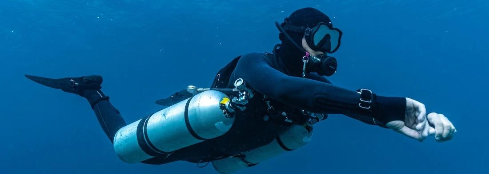

## ¿Por qué sidemount?
¡El buceo sidemount es como llevar tu propio traje espacial submarino! Imagina deslizarte bajo el agua con tanques a ambos lados de tu cuerpo, como un auténtico explorador submarino. Esta técnica te libera de cargar tanques en la espalda, ofreciéndote una libertad y movilidad increíbles bajo el agua. Con el sidemount, puedes sumergirte con mayor facilidad en lugares estrechos, explorar nuevos entornos y tener un acceso sencillo y visual a tu equipo. Es descubrir un estilo de buceo que te brinda más control y comodidad para disfrutar al máximo del mundo submarino.

## Objetivo del curso

Este curso está diseñado según los estándares oficiales **SDI Sidemount Diver** para enseñar a los buceadores certificados cómo utilizar de forma segura cilindros primarios de montaje lateral como alternativa a la configuración tradicional montada en la espalda (dentro de los límites de buceo recreativo sin descompresión).

## Metodología del curso

### Talleres en superficie de configuración
  * Opciones de cilindros, reguladores y arnés/ala (BCD) específicos de sidemount
  * Distribución de lastre adecuado y ajuste de trimado de botellas
  * Técnicas de aleteo y posición en el agua
  * Controles de manómetros y señales de comunicación

### Sesiones de teoría
  * Gestión de gas utilizando cilindros independientes y cambios de regulador (switch)
  * Planificación de la inmersión, tiempo máximo sin descompresión e intervalos en superficie
  * Solución de problemas: compartir gas y pérdidas de gas

### Sesiones en el agua
  * Entradas y salidas en el agua (desde costa y desde barco)
  * Colocación y retirada de cilindros laterales fuera del agua, en superficie (haciendo pie y sin hacer pie) y en profundidad
  * S-Drills específicos para sidemount y cambios de regulador
  * Chequeo de lastre, control de flotabilidad y trimado
  * Técnicas de propulsión en el agua, navegación con brújula y parada de seguridad con despliegue de boya (SMB)

## Requisitos oficiales, equipamiento y localización
* **Pre-requisitos del estudiante (Estándares SDI):**
  * Certificación Open Water Scuba Diver SDI o equivalente.
  * Edad mínima: 18 años (15 años con consentimiento paterno).
* **Equipamiento requerido:**
  * Cilindros independientes de volumen apropiado para sidemount.
  * Reguladores apropiados para configuración lateral con un manómetro en cada primera etapa y un total de dos segundas etapas.
  * Dispositivo compensador de flotabilidad (BCD/arnés) específico para configuración sidemount.
  * Traje de protección térmica adecuado, máscara, aletas, ordenador de buceo, brújula y boya de señalización (SMB).
* **Duración:** 3 días.
* **Dónde se imparte:** Sesiones prácticas en **L'Escala (Costa Brava)** y **Barcelona**.

## Otros detalles sobre el curso
En el curso de buceo sidemount grabamos con GoPro cada sesión para que puedas revisar y mejorar tu técnica en los debriefings, además de llevarte un recuerdo fantástico.
