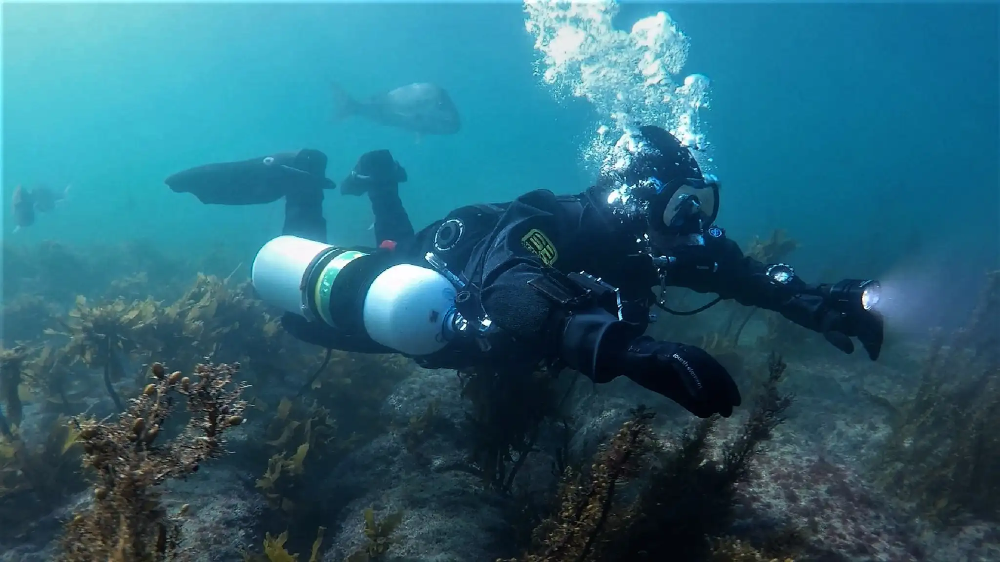

## ¿Por qué traje seco?
Descubre la comodidad y el aislamiento térmico incomparables del traje seco en nuestro curso especializado. Con este equipo podrás explorar aguas más frías durante todo el año con total confort y libertad de movimiento, minimizando la exposición térmica para una experiencia de buceo más cómoda y segura. Aprovecha los beneficios técnicos únicos que ofrece este equipo y perfecciona tu habilidad en su uso con nuestra formación especializada.

## Metodología del curso

### Talleres en superficie de configuración
  * Técnica para equiparse y desequiparse de forma autónoma y asistida
  * Cuidado, mantenimiento y reparaciones básicas (cremallera, protector y manguitos)

### Sesiones de teoría
  * Tipos de trajes secos (trilaminados, neopreno comprimido y neopreno)
  * Tipos de manguitos y sellos (látex, neopreno, silicona)
  * Ropa térmica interior (ratas de poliéster/polipropileno resistentes a la compresión)
  * Válvulas de inflado y desinflado ajustable
  * Lastrado adecuado y control de la flotabilidad neutra

### Sesiones en el agua
  * Control de flotabilidad neutra y trim con traje seco
  * Uso correcto de las válvulas de hinchado y vaciado
  * Conexión y desconexión del latiguillo de baja presión bajo el agua
  * Gestión de emergencias: válvula de inflado bloqueada y válvula de vaciado bloqueada
  * Maniobra de recuperación en caso de inversión (pies arriba)

## Requisitos oficiales, equipamiento y localización
* **Pre-requisitos del estudiante (Estándares SDI):**
  * Certificación Open Water Scuba Diver SDI, Junior Open Water o equivalente.
  * Edad mínima: 18 años (12 años con consentimiento paterno).
* **Equipamiento requerido:**
  * Equipo completo de buceo en aguas abiertas.
  * Traje seco con latiguillo de inflado y ropa interior térmica adecuada.
* **Duración:** 2 días.
* **Dónde se imparte:** Sesiones prácticas en **L'Escala (Costa Brava)** y **Barcelona**.

## Otros detalles sobre el curso
En el curso grabamos con GoPro cada sesión para que puedas revisar y mejorar tu técnica en vídeo, además de llevarte un recuerdo fantástico.
