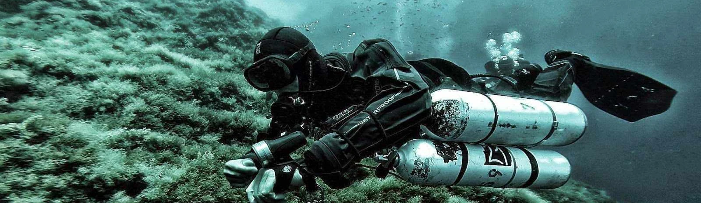

## ¿Por qué el buceo técnico?
Dar el paso del buceo recreativo al buceo técnico marca una transición significativa hacia un enfoque más detallado, riguroso y especializado en la exploración submarina. Esta evolución implica un compromiso mayor en términos de capacitación, equipo y preparación mental. El buceo técnico desafía los límites convencionales, permitiendo inmersiones más profundas, prolongadas y en entornos más desafiantes.

La formación en buceo técnico amplía el conocimiento teórico, perfecciona habilidades de buceo y enfatiza la seguridad, la planificación meticulosa y el dominio del equipo especializado. Este cambio requiere una mentalidad centrada en el perfeccionamiento constante, el dominio técnico y la gestión efectiva de situaciones complejas bajo el agua.

A pesar de su exigencia, el buceo técnico ofrece una gratificación única al explorar lugares más remotos y desafiantes, brindando la oportunidad de descubrir un mundo submarino aún más cautivador y enriquecedor.

## Objetivo del curso

El curso **TDI Intro to Tech** representa los fundamentos esenciales para ingresar al mundo del buceo técnico. Esta etapa marca un cambio significativo: el buceo deja de ser simplemente recreativo para convertirse en un compromiso serio y enfocado en el entrenamiento especializado. Los participantes deben estar preparados para elevar su nivel de esfuerzo y dedicación a través del estudio de materias más desafiantes y técnicas.

Este programa no solo proporciona conocimientos básicos, sino que exige un compromiso más profundo con la comprensión teórica y la aplicación práctica. Los estudiantes dejarán de ver el buceo como una actividad puramente recreativa para abrazar un enfoque riguroso y disciplinado, donde cada inmersión se convierte en una oportunidad de entrenamiento y perfeccionamiento.

## Metodología del curso

### Talleres en superficie de configuración
  * Configuración técnica del equipo (sidemount o doble botella), arnés y enrutado limpio de latiguillos
  * Técnicas de aleteo y posición corporal (trim horizontal)
  * Controles de manómetros y chequeos pre-inmersión
  * Comunicación, posicionamiento y trabajo en equipo
  * Anticipación y resolución de problemas

### Sesiones de teoría
  * Física y fisiología aplicadas al buceo técnico
  * Planificación del buceo y tiempo de runtime
  * Planificación de gases y presiones mínimas de retorno
  * Cálculo de consumo personal (SAC / RMV)

### Sesiones en el agua
  * Control absoluto de la flotabilidad y el trimado mientras se ejecutan tareas
  * Drills de falta de aire (S-Drills con latiguillo largo en flotabilidad neutra)
  * Drills de fallos en válvulas y reguladores (V-Drills)
  * Chequeo de lastre y flotabilidad
  * Ascensos y descensos controlados en equipo
  * Técnicas de propulsión avanzada (frog kick, modified frog kick, modified flutter, back kick y helicopter turn)
  * Navegación avanzada y despliegue de boya deco (SMB) manteniendo cota

## Requisitos oficiales, equipamiento y localización
* **Pre-requisitos del estudiante (Estándares TDI):**
  * Certificación mínima Open Water Scuba Diver SDI o equivalente.
  * Mínimo de **25 inmersiones registradas** en aguas abiertas.
  * Edad mínima: 18 años (15 años con consentimiento paterno).
* **Equipamiento requerido:**
  * Configuración técnica completa (sidemount o bibotella) con dos primeras etapas y segundas etapas (una con latiguillo largo de 1,5 m a 2,1 m y otra con latiguillo corto y collar).
  * Arnés y ala técnica acorde a la configuración.
  * Traje de protección térmica adecuado, máscara principal y máscara de respeto, aletas rígidas no partidas, ordenador de buceo/profundímetro, brújula, elementos de corte, pizarra/wetnotes, carrete/spool y boya de señalización (SMB).
* **Duración:** 4 o 5 días.
* **Dónde se imparte:** Sesiones de formación en **L'Escala (Costa Brava)** y **Barcelona**.

## Otros detalles sobre el curso
En el transcurso de este curso, cada sesión será grabada minuciosamente en vídeo con el propósito de permitir un análisis exhaustivo de cada detalle. Desde la configuración precisa del equipo hasta la disposición y técnica en el agua, cada aspecto será documentado para revisión posterior. Se recomienda encarecidamente a los participantes traer su propio equipo personal, permitiéndoles trabajar con la configuración que conocen y llevárselo ajustado de manera óptima. Es fundamental tener en cuenta la exigencia de este curso: se espera que los alumnos lleguen mentalmente preparados y con una base sólida de fundamentos teóricos previamente adquiridos.
