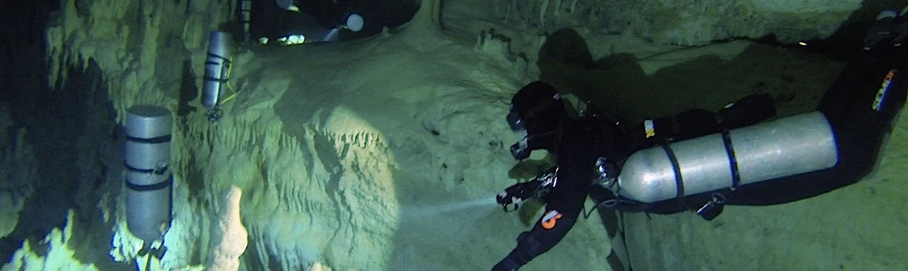

## ¿Por qué buceo técnico en sidemount (montaje lateral)?
La configuración de **buceo sidemount** (o **buceo en montaje lateral**) es un estilo de buceo en el que los tanques de gas se colocan a los lados del buceador en lugar de llevarlos en la espalda, como en el buceo con tanque trasero tradicional (backmount). Esta técnica de **buceo técnico en sidemount** se ha vuelto cada vez más popular debido a sus ventajas en términos de comodidad, maniobrabilidad y acceso al equipo.

Principales ventajas del buceo en sidemount:
* Redundancia total de gas y reguladores independientes
* Acceso a las griferías instantáneo y visual
* Control de la flotabilidad y trim optimizado
* Hidrodinámica superior
* Comodidad dentro y fuera del agua
* Mayor facilidad en todas las habilidades en buceo técnico

Es además la configuración más adecuada y utilizada en los entornos bajo techo, siendo este curso los cimientos sobre los que construir a los futuros buceadores de cuevas.

## Objetivo del curso

El curso se distingue por su exigencia y enfoque preciso en acelerar la curva de aprendizaje y la memoria muscular para alcanzar la excelencia en el buceo. Diseñado meticulosamente, busca potenciar habilidades técnicas y cognitivas, así como desarrollar una destreza excepcional en el agua. A través de un riguroso entrenamiento, se promueve una sólida base de conocimientos y prácticas específicas que garantizan un desempeño sobresaliente bajo diversas condiciones. Este programa desafía a los participantes a alcanzar un nivel óptimo de competencia, priorizando la seguridad y el dominio completo de las técnicas para lograr estándares superiores en la experiencia de buceo.

## Metodología del curso

### Talleres en superficie de configuración
  * Configuración personalizada del arnés, ala específica de sidemount y distribución de lastre
  * Opciones de cilindros, bungees y mosquetones
  * Configuración de reguladores (latiguillo largo / long hose y latiguillo corto) y manómetros independientes
  * Trimado de botellas a lo largo del cuerpo y cómo mantener el perfil hidrodinámico
  * Técnicas de aleteo, comunicación y trabajo en equipo
  * Anticipación y resolución de problemas

### Sesiones de teoría
  * Gestión de gas utilizando cilindros independientes y cambios de regulador (gas switch)
  * Planificación del buceo y tiempo de runtime
  * Cálculo de consumo personal (SAC / RMV)
  * Resolución de emergencias: compartir gas y fallos o pérdidas de gas

### Sesiones en el agua
  * Entradas y salidas del agua (desde costa y desde barco)
  * Colocación y retirada de cilindros laterales fuera del agua, en superficie y en profundidad
  * S-Drills específicos para sidemount y donación de gas con latiguillo largo
  * Gestión de fallos en válvulas y reguladores (V-Drills y flujo libre)
  * Chequeo de lastre, flotabilidad neutra y trimado a medida que disminuye la presión de los tanques
  * Técnicas de propulsión avanzada (frog kick, modified frog kick, modified flutter, back kick y helicopter turn)
  * Ascensos y descensos controlados, navegación avanzada y despliegue de boya (SMB)

## Requisitos oficiales, equipamiento y localización
* **Pre-requisitos del estudiante:**
  * Certificación mínima Open Water Scuba Diver (recomendado experiencia previa o TDI Intro to Tech).
  * Edad mínima: 18 años (15 años con consentimiento paterno).
* **Equipamiento requerido:**
  * Dos cilindros independientes apropiados para sidemount.
  * Dos reguladores completos para configuración lateral (un manómetro en cada primera etapa, una segunda etapa con latiguillo largo y otra con latiguillo corto y collar).
  * Arnés y ala (BCD) específicos para configuración sidemount.
  * Traje de protección térmica adecuado, máscara, aletas técnicas, ordenador de buceo, brújula, carrete/spool y boya de señalización (SMB).
* **Duración:** De 2 a 4 días, según las necesidades del alumno.
* **Dónde se imparte:** Sesiones en **L'Escala (Costa Brava)** y **Barcelona**, en puntos seleccionados específicamente para el desarrollo de las habilidades técnicas.

## Otros detalles sobre el curso
En el transcurso de este curso, cada sesión será grabada minuciosamente en vídeo con el propósito de permitir un análisis exhaustivo de cada detalle en los debriefings. Desde la configuración precisa del equipo hasta la disposición y técnica en el agua, cada aspecto será documentado para revisión posterior. Se recomienda encarecidamente a los participantes traer su propio equipo personal, permitiéndoles trabajar con la configuración que conocen y llevárselo ajustado de manera óptima. Es fundamental tener en cuenta la exigencia de este curso: se espera que los alumnos lleguen mentalmente preparados y con una base sólida de fundamentos teóricos previamente adquiridos.
