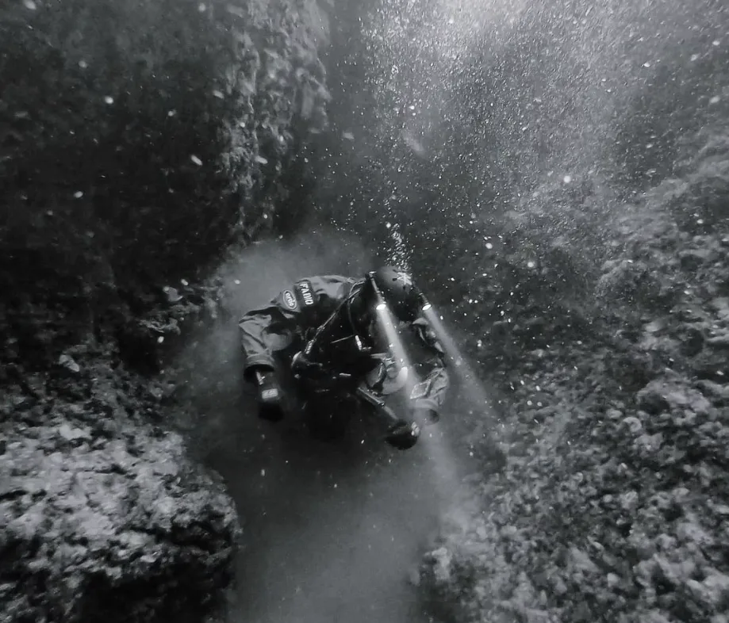
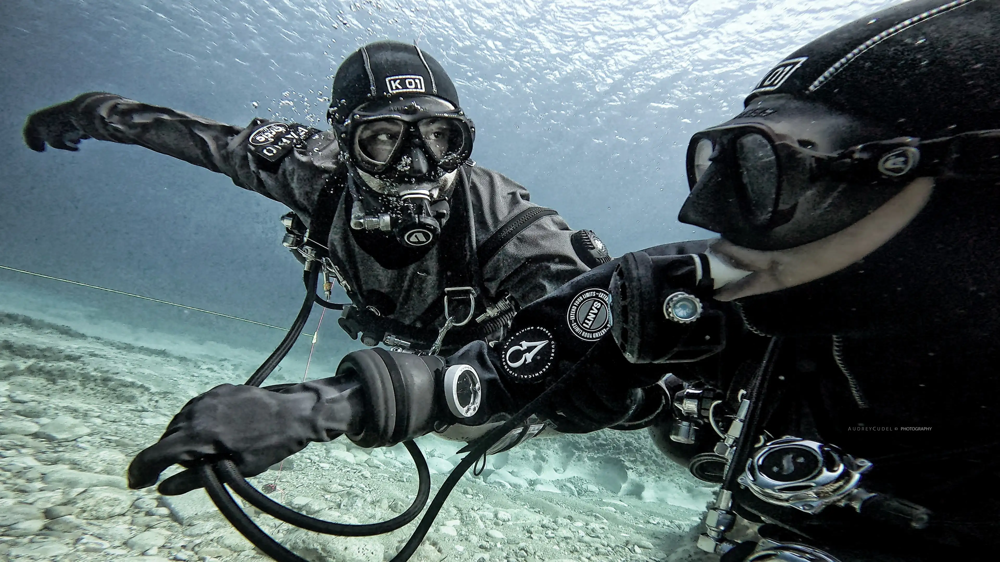
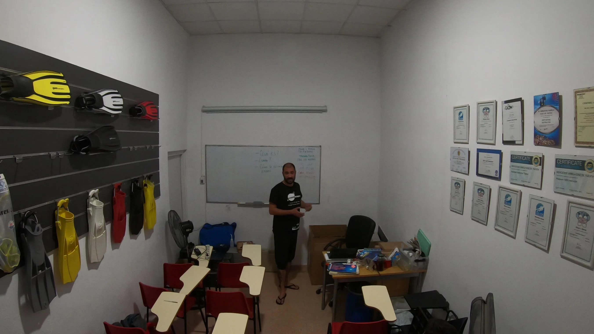
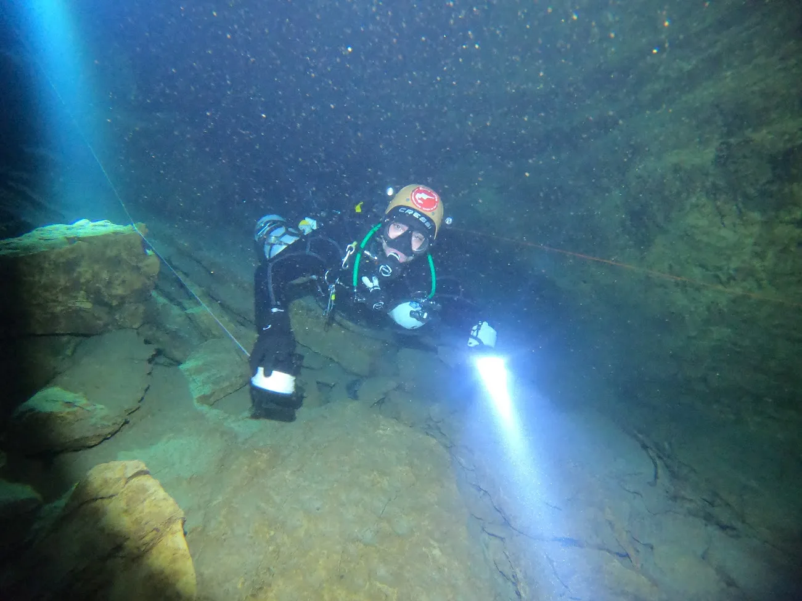
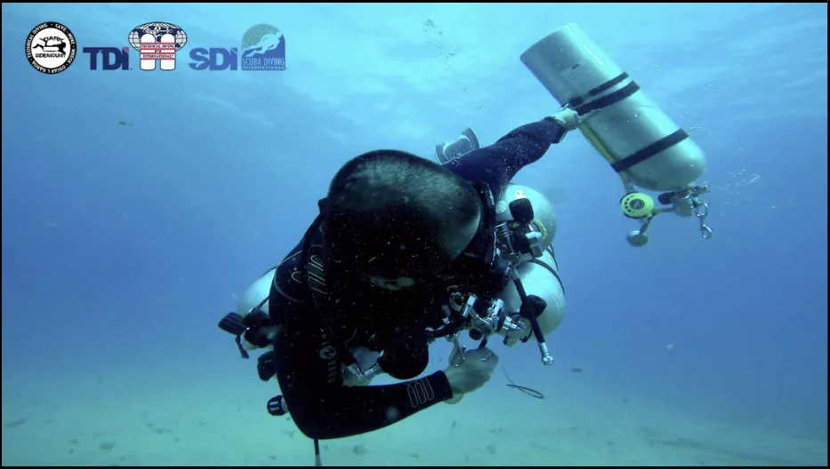
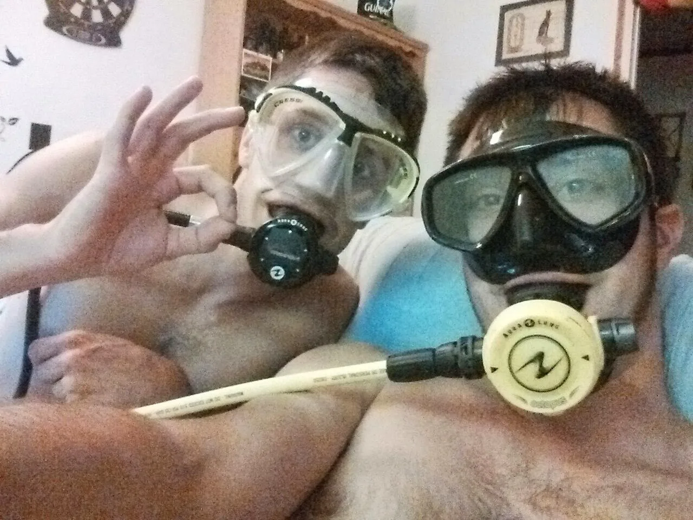



  

    

      

        <h3 class="title">Actualidad</h3>
        <h4>Fundador e Instructor Principal de Sidemount Spain</h4>
        

            
            
Como fundador e instructor principal de Sidemount Spain (sidemount.es), dirijo la formación especializada en buceo técnico, trimado avanzado y configuración lateral en Cataluña y España. Mi vida gira en torno al buceo técnico y en cuevas, una disciplina que combino con mi profesión como ingeniero de datos y mapas. Esta combinación me permite aplicar la máxima rigurosidad técnica, el análisis métrico y la precisión matemática a la enseñanza del sidemount y la espeleología subacuática. En Sidemount Spain no enseñamos sidemount como una especialidad secundaria de catálogo: nos dedicamos de forma exclusiva a formar a buceadores técnicos bajo los estándares más exigentes de la industria.

            
Fundador e instructor principal de Sidemount Spain (sidemount.es). Especialista en formación técnica en montaje lateral (sidemount) y buceo en cuevas en Cataluña y España, fusionando la ingeniería de datos con la máxima precisión y disciplina bajo el agua.

        

      

    

    

      

        <h3 class="title">2024</h3>
        <h4>Especializándome como instructor técnico con los mejores en la especialidad</h4>
        

            
            
Durante el transcurso de este año, he alcanzado un hito significativo en mi desarrollo profesional como instructor al obtener la certificación en sidemount técnico en Malta, bajo la tutela de Audrey Cudel, una destacada instructora reconocida en la especialidad. Esta evaluación representó un proceso riguroso y exigente que ha ampliado mi competencia y conocimiento en técnicas avanzadas de buceo, específicamente en el contexto del sidemount. La instrucción recibida y el éxito obtenido en esta evaluación constituyen una validación tangible de mi habilidad para impartir formación de alta calidad en este campo especializado del buceo técnico. Este logro no solo refleja mi dedicación y compromiso con la excelencia profesional, sino que también fortalece mi capacidad para brindar una enseñanza efectiva y segura a futuros alumnos en esta disciplina exigente y técnica del buceo.

            
Durante este año, he avanzado como instructor al completar con éxito mi evaluación de sidemount técnico en Malta, bajo la dirección de Audrey Cudel, una instructora líder en la especialidad. Esta certificación representa un hito significativo en mi desarrollo profesional, validando mi competencia para impartir formación de alta calidad en técnicas avanzadas de buceo.

        

      

    

    

      

        <h3 class="title">2023</h3>
        <h4 style="text-align: right">Comienzo a ser instructor</h4>
        

            
            
Tras una intensa trayectoria como buceador especializado en cuevas y la configuración sidemount, sentí un fuerte llamado en mi interior, una necesidad de compartir toda la valiosa experiencia y conocimientos que había adquirido a lo largo de mi recorrido. Esa convicción me llevó a tomar la decisión de convertirme en instructor, aspirando a guiar a otros en el mismo camino que he recorrido para llegar a ser el buceador de cuevas que soy en la actualidad. La pasión por transmitir no solo las habilidades técnicas sino también la mentalidad disciplinada y el profundo respeto por este entorno subacuático motivaron mi elección de convertirme en un instructor, con la esperanza de inspirar y preparar a otros buceadores para abrazar este apasionante y desafiante mundo submarino.

            
Tras mi experiencia en cuevas y el buceo con configuración sidemount, sentí una fuerte vocación por transmitir mis conocimientos. Decidí convertirme en instructor con el deseo de compartir tanto habilidades técnicas como la mentalidad y el respeto necesarios para explorar el mundo submarino, aspirando a guiar a otros buceadores en su viaje hacia la exploración de cuevas submarinas.

        

      

    

    
    

      

        <h3 class="title">2020</h3>
        <h4>Comienzo con el buceo de cuevas</h4>
        

            
            
Después de acumular una sólida experiencia en el buceo en aguas abiertas, sentí la llamada para adentrarme en un nuevo desafío: el buceo en cuevas. Con esa meta en mente, decidí seguir mi camino hacia el buceo de cuevas bajo la guía experta de Javier de Miguel, en la cautivadora cueva del Moraig. Fue allí donde consolidé los fundamentos esenciales para desenvolverme con seguridad en este entorno desafiante y fascinante. A través del riguroso entrenamiento y la orientación experta, adquirí la disciplina y el enfoque necesarios para operar de manera segura en estas condiciones, comprendiendo la importancia de la preparación meticulosa y el respeto por el entorno subterráneo. Este período de formación no solo fortaleció mis habilidades, sino que también me brindó una comprensión más profunda y una apreciación renovada por la belleza y complejidad del buceo en cuevas.

            
Bajo la guía experta de Javier de Miguel en la cueva del Moraig, consolidé los fundamentos esenciales para adentrarme de manera segura en el desafiante mundo del buceo en cuevas. Este riguroso entrenamiento no solo fortaleció mis habilidades, sino que también amplió mi comprensión y aprecio por la belleza y complejidad de este entorno submarino.

        

      

    

    

      

        <h3 class="title">2018</h3>
        <h4 style="text-align: right">Comienzo en el buceo técnico</h4>
        

            
            
El mundo del buceo técnico se abrió ante mí como un desafío irresistible después de mi incursión inicial en el buceo recreativo. Fascinado por la idea de explorar cuevas submarinas al estilo de un astronauta, decidí adentrarme en el buceo técnico desde sus cimientos, adoptando la configuración sidemount. Determinado a dominar esta disciplina desde el principio, me formé con el antiguo referente en el sidemount en España. El proceso fue exigente y complejo, llevándome a superar desafíos que ampliaron mis límites. A pesar de la intensidad, encontré una nueva pasión en este enfoque más técnico del buceo. La fusión entre la exploración intrépida y el desafío técnico me atrapó por completo, convirtiendo lo que solía ser un pasatiempo en una dedicación seria y absorbente que me motivó a explorar aún más las profundidades desconocidas del mundo submarino.

            
Me adentré en el desafiante mundo del buceo técnico, adoptando la configuración sidemount, con el antiguo referente en el sidemount en España. Este enfoque exigente y emocionante amplió mis límites, convirtiendo mi pasión por el buceo en una dedicación absorbente, fusionando la exploración intrépida con desafíos técnicos, llevándome a explorar aún más las profundidades submarinas desconocidas.

        

      

    

    

      

        <h3 class="title">2014</h3>
        <h4>Comienzo a bucear</h4>
        

            
            
Inspirado por la pasión de mi hermano, me sumergí en el mundo del buceo realizando mi curso de Open Water en Barcelona. Con rapidez adquirí las habilidades necesarias y comencé a explorar como buceador recreativo, navegando por las aguas de Canarias, los exuberantes arrecifes de Filipinas, las profundidades de Borneo en Indonesia y los cautivadores paisajes del Mar Rojo. Durante esa temporada, impulsado por mi curiosidad y deseo de perfeccionar mis habilidades, continué mi formación completando cursos adicionales como Advanced y Rescue de PADI. Estos cursos no solo expandieron mis conocimientos técnicos, sino que también fortalecieron mi confianza y entendimiento de la seguridad en el buceo, permitiéndome sumergirme con mayor profundidad en la maravillosa experiencia submarina.

            
Inspirado por mi hermano, comencé mi aventura en el buceo en Barcelona y exploré lugares como Canarias, Filipinas, Borneo e Indonesia. Completé cursos de PADI como Advanced y Rescue, ampliando mis habilidades y confianza en esta experiencia submarina.

        

      

    

  


